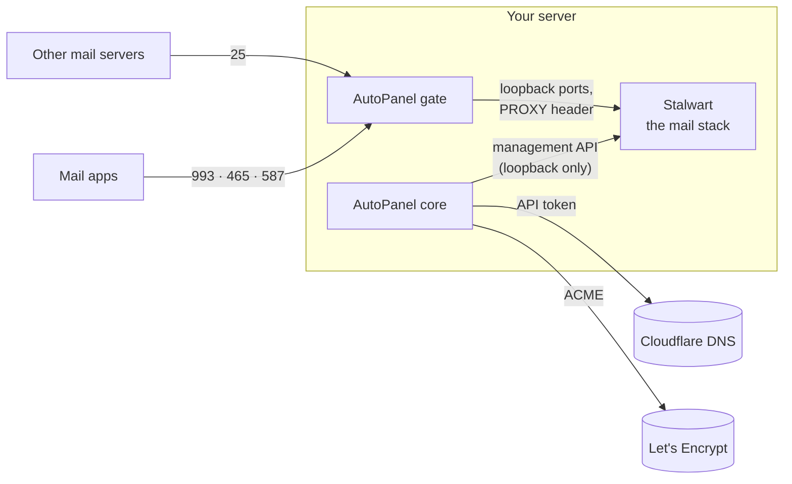

# Mail in AutoPanel

How mail works in the panel: what each Mail screen shows, what each key does, how a message gets
in and out, and what to check when it doesn't. The README's [Run mail](README.md#run-mail) section
is the short version; the reasons behind the design are in
[docs/decisions/mail.md](docs/decisions/mail.md).

The examples use `example.com` as the mail domain, `mail.example.com` as the mail host and
`192.0.2.10` as the server's address.

- [How the parts fit](#how-the-parts-fit)
- [Before you start](#before-you-start)
- [The Mail menu](#the-mail-menu)
- [Set up mail](#set-up-mail)
- [Mail → Server](#mail--server)
- [Mail → Domains](#mail--domains)
- [Taking over a record](#taking-over-a-record)
- [Mail → Accounts](#mail--accounts)
- [Setting up a mail app](#setting-up-a-mail-app)
- [The background pass](#the-background-pass)
- [Removing mail](#removing-mail)
- [Checking from outside](#checking-from-outside)
- [Troubleshooting](#troubleshooting)
- [From the command line](#from-the-command-line)

## How the parts fit



- **Stalwart** is the mail server. It runs as a stack named `mail` under rootless Podman, like any
  other stack, and listens on loopback ports only.
- **The gate** holds the four public mail ports and forwards each connection to Stalwart with a
  PROXY header, so Stalwart sees the real address of each client.

  | Port | For | Security |
  | --- | --- | --- |
  | 25 | mail arriving from other servers (SMTP) | STARTTLS |
  | 465 | mail apps sending (submission) | SSL/TLS |
  | 587 | mail apps sending (submission) | STARTTLS |
  | 993 | mail apps reading (IMAP) | SSL/TLS |

- **The core** sets Stalwart up through its management API, keeps the DNS records, rotates the DKIM
  keys and hands Stalwart the mail host's certificate. The management API is on a loopback port that
  is never forwarded.
- **The loopback rule** is a firewall rule AutoPanel loads so that only the gate can reach
  Stalwart's loopback ports: no other stack and no other user on the server.
- Every key and setting of mail (the API key, the DKIM private keys, the DNS token) is sealed under
  AutoPanel's master key.

## Before you start

| Need | Why | How to check |
| --- | --- | --- |
| A processor that runs Stalwart: x86-64-v2 or arm64 | Stalwart's build exits at once on less. On a virtual machine, set the CPU type to `host` or `x86-64-v2` | Set up mail refuses with "this processor cannot run the mail server" |
| Port 25 open **outwards** | Other servers receive mail on 25. Many providers block it until asked | `nc -vz gmail-smtp-in.l.google.com 25` from the server |
| Ports 25, 465, 587, 993 open **inwards** | A firewall on the server or at the provider drops them otherwise | [Checking from outside](#checking-from-outside) |
| The reverse name (PTR) of the server's address points at the mail host | Receivers distrust a server whose address has no matching name. Only the hosting provider can set it | `dig +short -x 192.0.2.10` answers `mail.example.com.` |
| The domain is under **Routes → Domains** | Mail is set up only for domains you registered | the Domains panel lists it |
| A decision on who writes DNS | AutoPanel, with a Cloudflare token, or you, by hand | **Certs → Cloudflare token…** |

**A firewall on the server.** With `ufw`, AutoPanel opens the four ports itself: at set-up, or
later with **Open ports** on Mail → Server. With `firewalld`, or with rules it cannot read, it
shows the commands to run instead. A firewall in front of the server, at the hosting provider (a
security group, a cloud firewall), is yours to open: AutoPanel cannot see it.

## The Mail menu

Open it with Alt+M. Each row opens a panel; `q` or Esc closes a panel. In a panel, a button's key
is its marked letter, pressed alone. Tab or a mouse click moves between a panel's lists.

| Row | What it does |
| --- | --- |
| Set up mail… | asks two questions and starts mail. Greyed out once mail is set up |
| Domains… | the domains that receive mail, each one's DNS records and DKIM keys |
| Accounts… | the mailboxes and each one's app passwords |
| Server… | Stalwart's state, the certificate, the last pass and its problems |
| DNS records… | every record in the form a DNS provider's page asks for, to copy from |

The Domains, Accounts and Server panels open at any time. Until mail is set up they say "Mail is
not set up: Mail › Set up mail" where their facts would be. While Stalwart is still starting,
**Add…**, **Sync** and **DNS records…** answer "Stalwart is still being set up: see Mail › Server".

## Set up mail

1. **Mail → Set up mail…** asks for the mail host (`mail.example.com`: a name under one of your
   domains) and the first domain that receives mail (`example.com`: a registered one).
2. The mail stack's **review** opens, as for any stack: its image, ports, mounts and findings.
   It also lists mail's four public ports with what the server's firewall does to each. A port the
   firewall blocks is ticked `[x] open it`; **Leave it as it is** (`l`) unticks it. A port
   AutoPanel cannot open here shows `[!] by hand`, with the commands and **Copy commands** (`y`).
   Nothing has been written yet. Leave the review, or quit, and Set up mail opens again with your
   answers.
3. **Add and start** makes the whole setup as one step: the stack's user, the loopback rule, the
   stack's files, the stack started, the ticked ports opened in the firewall, and the record that
   mail is set up. If any part fails, the
   parts before it are undone and the message says which part failed.
4. Within a minute or two the core sets Stalwart up through its API. **Mail → Server** shows the
   step move from `waiting for the stack` to `setting up` to `ready`.
5. Once it is `ready`, the gate forwards the mail ports, and the first [pass](#the-background-pass)
   publishes the DNS records (with a Cloudflare token) or lists them for you to enter (without).

If AutoPanel restarts between step 1 and step 3, the answers are gone: "the setup was not kept",
and you start again from step 1.

## Mail → Server

One screen of facts, read again with **Reload** (`r`); **Sync** (`s`) starts a pass now, and
**Open ports** (`p`), shown when a port needs it, opens mail's blocked ports in the firewall.

| Line | Shows | Healthy value |
| --- | --- | --- |
| Mail host | the name mail apps and MX records point at | `mail.example.com` |
| State | where the setup is, followed by the setup's last failure if there was one | `ready` |
| Stack | the `mail` stack's state, as Services → Stacks shows it | `deployed` |
| Loopback rule | the rule that keeps Stalwart's ports for the gate alone | `ok` |
| Certificate | the mail host's certificate as Stalwart serves it | `ok until 2027-02-09` |
| Domains | the domains that receive mail | your domains |
| Last pass | when the DNS, DKIM and certificate pass last ran | within the last hour |
| Ports | each public port with the firewall's verdict and who allowed it | `tcp/25: allowed · mail`, and so on |
| Problems | what the last pass could not do, one line each | `none` |

**State** goes from `waiting for the stack` to `setting up` to `ready`. A failure is shown after
it, as in `setting up · …`, and the step is tried again by itself.

**Ports** has a line per port. After the verdict comes who made the rule that allows it: `mail`
(AutoPanel, for mail: it is closed again if mail is removed), `a rule not AutoPanel's` (yours: it
is left alone), or, for a blocked port AutoPanel cannot open, the commands that would.

**Certificate** is `-` before the first pass, then one of:

| Value | Means |
| --- | --- |
| `ok until …` | Stalwart serves the certificate AutoPanel holds |
| `not issued` | AutoPanel could not obtain it: [see below](#the-certificate-says-not-issued) |
| `not handed over` | it was issued, but Stalwart refused it; the `the certificate: …` problem says why |
| `handed over, not served` | Stalwart has it but did not come back from the restart that puts the first certificate to use: see the stack's log |
| `unknown` | Stalwart's certificates could not be read |

**Loopback rule** is checked every hour and at every start:

| Value | Means |
| --- | --- |
| `ok` | the rule is loaded |
| `reloaded at …` | it was missing and AutoPanel loaded it again at that time |
| `failed: …` | the firewall could not be read, or the rule could not be loaded; the text says why |
| `unknown: …` | the mail stack's user was not found, so the rule could not be checked |

**Problems** lines start with what failed:

| Line starts with | Means | See |
| --- | --- | --- |
| `the domains: …` | AutoPanel's own list of mail domains could not be read | the store; the text after it |
| `the mail server's domains: …` | Stalwart did not answer | is the `mail` stack running? Its log |
| `example.com: the mail server does not hold the domain` | the domain is in AutoPanel's list but not in Stalwart | remove the domain and add it again |
| `example.com: …` | Stalwart could not say which records the domain needs | the text after it; the stack's log |
| `example.com DNS: …` | a record could not be read or written at Cloudflare | [A record shows `failed`](#a-record-shows-failed) |
| `example.com DKIM: …` | a DKIM key could not be made or moved to its next step | the text after it; **Sync** to try again |
| `the mail host's address: …` | the server's public IPv4 address could not be found | the server's network |
| `mail.example.com DNS: …` | the mail host's own records could not be kept | as for a domain |
| `the certificate: …` | the mail host's certificate could not be issued or handed to Stalwart | [The certificate says `not issued`](#the-certificate-says-not-issued) |
| `expired app passwords: …` | an expired pending app password could not be destroyed | it is tried again next pass |

## Mail → Domains

Two lists and a text pane: the **Domains** on the left; on the right the selected domain's
**Records** (state, type, name), and under them **Details**, which shows the selected record in
full, the domain's DKIM keys and when the last pass ran. The last row on the left, `mail.example.com (mail host)`, is not a mail domain:
it holds the mail host's own records (its address, its SPF).

| Key | Button | Does |
| --- | --- | --- |
| `a` | Add… | receive mail for another registered domain |
| `r` | Remove… | stop receiving mail for the selected domain. Refused while it has accounts |
| `t` | Take over… | replace a record someone else wrote that holds the selected record's place |
| `s` | Sync | run the pass now |
| `n` | DNS records… | every record in the form a DNS provider's page asks for, with **Copy value** (`c`) |

Each record has a name, a type, the value it needs, what is **in the zone now**, what it is **for**,
and a state:

| State | Means | What to do |
| --- | --- | --- |
| `ok` | the zone holds it as AutoPanel wants it | nothing |
| `publishing` | just written; resolvers will have it within minutes | wait, then **Sync** |
| `different` | the zone holds a record of that kind AutoPanel did not write | [Take it over](#taking-over-a-record), or leave it on purpose |
| `manual` | no Cloudflare token: AutoPanel cannot write this zone | enter the value at your DNS provider |
| `failed` | Cloudflare refused it; the row's error says why | [A record shows `failed`](#a-record-shows-failed) |

The records every mail domain needs, and what each one does, are in the README's
[DNS: what mail needs](README.md#dns-what-mail-needs).

**DKIM keys**, in the Details pane, lists each key pair by its selector (`ap202611e` is the Ed25519 key made in November
2026, `ap202611r` the RSA one) and its step:

| Step | Means |
| --- | --- |
| `published` | its record is in the zone (or waits for you to enter it); Stalwart does not sign with it yet |
| `signing` | public resolvers answer its record, and Stalwart signs with it |
| `retired` | a newer pair signs; this record stays published for a week so mail already sent still verifies |

A key moves from `published` to `signing` by itself, no sooner than ten minutes after it was
published and only once public resolvers answer its record. Every 90 days a new pair is made.

## Taking over a record

A domain that had mail somewhere else before (a registrar's forwarding, another mail provider) or
that already has an SPF or DMARC record shows those records as `different`. AutoPanel never
replaces a record it did not write without being told to, so until you take them over:

- an MX record that is `different` means the domain's mail still goes to the other provider;
- an SPF record that is `different` means receivers are not told this server may send for the
  domain, so its mail fails SPF;
- a DMARC record that is `different` keeps the old policy.

To take one over:

1. **Mail → Domains**, select the domain, then select the record whose state is `different`. Its
   **In the zone now** line shows what holds its place.
2. Press **Take over…** (`t`). The question shows the record as it is now and as AutoPanel wants
   it.
3. Confirm. An **SPF** record is merged: AutoPanel adds the mail host to the record that is there
   and keeps the rest. Any other record is deleted and AutoPanel's is published.
4. The next pass publishes the record; **Sync** (`s`) runs it now. The state goes to `publishing`,
   then `ok`.
5. Repeat for each `different` record, and for the mail host's row at the bottom.

Take over the MX last if the domain receives mail elsewhere today: from the moment the new MX
answers, new mail arrives here.

"that record is held by no other: nothing to take over" means the selected record is not
`different`. Without a Cloudflare token there is nothing to take over either: you change the
records at your DNS provider yourself.

## Mail → Accounts

The **Accounts** on the left (address, used, quota). On the right, the selected account's
**Details**, and under them its **App passwords**, each with its device name, the day it was made,
and `in use` or `pending until …`.

| Key | Button | Does |
| --- | --- | --- |
| `a` | Add… | make a mailbox, `name@domain`, of a domain that receives mail. 5 GB by default |
| `n` | New app password… | make a password for one device of the selected mailbox, shown once |
| `v` | Revoke… | stop the selected app password: that device no longer signs in |
| `o` | Lock password… | for a mailbox made before v0.2.9: replace its typed password with one no one knows |
| `r` | Remove… | delete the mailbox and all its mail. This cannot be undone |
| `d` | Disable / Enable | stop every sign-in to the mailbox, or allow it again. Its mail, app passwords and aliases are kept |
| `i` | Aliases… | set the other addresses of mail's domains that deliver to the mailbox |
| `w` | Forward… | send the mailbox's mail on to an address outside mail's domains; an empty line stops it |
| `c` | Keep copy | keep a copy of forwarded mail in the mailbox, or stop keeping one (asks first) |

**Forwarding:**

- Mail the server marks as spam is not sent on: it stays in the mailbox.
- A forwarded message leaves with the mailbox's own address as its sender on the envelope, so a
  message that cannot be delivered comes back to the mailbox, not to whoever wrote it.
- **One address by default.** The mail server sends a message on to one address unless its
  administrator raises that in the server itself; the panel refuses more than it will send to.
- **Some forwarded mail is refused by strict recipients** (Gmail, for one): a message from a
  domain that asks for strict checks (DMARC) and does not sign its mail (DKIM). Signed mail
  passes, because forwarding changes nothing of the message.
- With no copy kept, a message that cannot be sent on goes back to its sender.
- A mailbox whose owner wrote a filter of their own in the mail server (a Sieve script) shows
  that instead, and the panel does not change it.

A mailbox's own password is generated by AutoPanel and told to no one. Devices sign in with **app
passwords**, one per device, so one device can be cut off without touching the others. Right after
a mailbox is made, the panel offers to make its first app password.

The DMARC and TLS reports of a domain go to `postmaster@` it: make that mailbox if you want to
read them. One account is the mail server's administrator, which AutoPanel itself works through:
the panel refuses to change or delete it.

## Setting up a mail app

1. **Mail → Accounts**, select the mailbox, press **New app password…** (`n`) and name the device.
2. The dialog shows the password **once**: as one line, in groups of four to check it by eye, and
   as a QR code that holds the password alone. **Copy password** (`p`) puts it on the clipboard of
   the computer you run the panel from, also over SSH; closing the dialog empties the clipboard.
3. In the mail app, choose a manual or "other" account and enter:

   | Setting | Value |
   | --- | --- |
   | User name | the full address, `ana@example.com` |
   | Password | the app password |
   | Incoming (IMAP) | `mail.example.com`, port 993, SSL/TLS |
   | Outgoing (SMTP) | `mail.example.com`, port 465, SSL/TLS; or port 587, STARTTLS |

4. Once the app has signed in, press **Done** (`d`). An app password is **pending** for ten
   minutes: if Done is not pressed by then, it stops working and is destroyed, and you make
   another. **Cancel** revokes it at once.

## The background pass

Once an hour, after every change, and whenever you press **Sync**, the core runs one pass:

1. For each mail domain: makes or moves along its DKIM keys, reads the records Stalwart needs, and
   publishes or checks each one at Cloudflare.
2. The same for the mail host's own records.
3. Destroys app passwords that were never kept.
4. Last, obtains the mail host's certificate if needed and hands it to Stalwart. The first
   certificate restarts Stalwart once; a renewal does not.

**Sync** answers at once and the pass runs in the background: press **Reload** (Server) or reopen
the panel a few seconds later to see its result. **Mail → Server** shows when it last ran and what
it could not do. The pass needs the vault: after a restart it runs once the keyfile, or an admin's
login, has opened it.

## Checking from outside

Run these from another computer, not the server.

```sh
# Where the domain's mail goes, and who may send for it
dig +short MX example.com
dig +short TXT example.com
dig +short TXT _dmarc.example.com
dig +short TXT ap202611e._domainkey.example.com

# The mail host's address, and its reverse name
dig +short A mail.example.com
dig +short -x 192.0.2.10

# Each port answers, with a certificate for the mail host
openssl s_client -connect mail.example.com:993 -servername mail.example.com </dev/null
openssl s_client -connect mail.example.com:465 -servername mail.example.com </dev/null
openssl s_client -starttls smtp -connect mail.example.com:587 </dev/null
openssl s_client -starttls smtp -connect mail.example.com:25 </dev/null
```

The real test is a message each way:

- **Out:** send from a mailbox here to an outside mailbox (Gmail, Outlook). Open the received
  message's original and read its `Authentication-Results` header: it should say `spf=pass`,
  `dkim=pass` and `dmarc=pass`.
- **In:** reply from the outside mailbox, and see it arrive.

## Troubleshooting

Start at **Mail → Server**. Its State and Problems lines name most faults.

### Mail → Server never says `ready`

| State | Check |
| --- | --- |
| `waiting for the stack` | **Services → Stacks**: is `mail` active? Its log (below) says why Stalwart did not start. On a virtual machine, check the CPU type |
| `setting up · …` | the text after the dot is the failure. A time-out usually means Stalwart was still starting: it is tried again by itself |
| "Mail is not set up: Mail › Set up mail" | the setup was never applied: **Mail → Set up mail** |

The mail stack's log: **Services → Stacks**, select `mail`, open its log; or
`sudo autopanel --call services.logs '{"name":"mail","limit":100}'`. Secrets in it are masked.

### Mail is sent and never arrives

Open **System → Host checks**. Two findings explain most of it, and both are your hosting
provider's to fix, not AutoPanel's:

| Finding | What it means | What to do |
| --- | --- | --- |
| "No connection out to port 25 gets through" | the provider blocks outgoing mail, as most do until asked | ask them to open port 25 for this server |
| "The server's address does not name the mail host back" | the address's reverse name (PTR) is not the mail host; many receivers refuse such mail | ask them to set the reverse name to the mail host |

Both are read again at the next hourly pass, or at once with **Sync** on **Mail → Server**.

### The certificate says `not issued`

- The mail host's **A record** must resolve to this server, and must not be proxied through
  Cloudflare. `dig +short A mail.example.com` from outside.
- With a Cloudflare token, every certificate comes through DNS, so the token must reach the zone
  of the mail host's domain.
- Without a token, ports 80 and 443 must reach the server from outside.
- After fixing it, press **Sync**. The `the certificate: …` problem line gives the reason, and
  **Certs → Certificates** keeps the last order's failure for the mail host.
- A certificate from Let's Encrypt's **staging** service is issued, but mail apps warn about it or
  refuse it. Switch to production under **Certs → Type**, then **Sync**.

### Mail from outside does not arrive

1. `dig +short MX example.com` must answer the mail host. If it answers another provider, the MX
   record is `different`: [take it over](#taking-over-a-record).
2. Port 25 must reach the server: `openssl s_client -starttls smtp -connect mail.example.com:25`
   from outside. No answer means a firewall drops it. **Mail → Server** shows the server's own
   firewall: a port that reads `blocked` is opened with **Open ports** (`p`). If every port reads
   `allowed` there, the firewall is the provider's. **System → Host checks** also says when the
   firewall blocks a mail port.
3. The address must be a mailbox: **Mail → Accounts**. Mail to an address that does not exist is
   refused.
4. The sender's bounce message says what the server answered; the mail stack's log shows the
   attempt.

### Mail sent from here is refused or lands in spam

Read the `Authentication-Results` header of a message that did arrive somewhere.

| It says | Cause | Fix |
| --- | --- | --- |
| `spf=fail` or `softfail` | the domain's SPF record does not name this server | the SPF record is `different`: take it over (it is merged), or add `a:mail.example.com` yourself |
| `dkim=none` | no key signs yet | **Mail → Domains**: the DKIM keys are still `published`. They move to `signing` once their records answer; with DNS by hand, enter them |
| `dkim=fail` | the record in the zone is not the key Stalwart signs with | the DKIM record's value was cut or changed: paste it again whole |
| `dmarc=fail` | SPF and DKIM both fail, or an old DMARC record is stricter | fix the two above; take over a `different` DMARC record |

Other causes:

- **Port 25 is blocked outwards.** Nothing is delivered at all, and the mail stack's log shows
  connection time-outs. Ask the provider to open it.
- **No reverse name (PTR).** Many receivers refuse or junk the mail. Only the provider can set it.
- **A new address has no reputation.** The first messages to a large provider may be junked even
  with everything passing; marking them "not spam" and replying helps.

### A mail app cannot sign in

- The user name is the **full address**, not the part before the `@`.
- The password is an **app password**. A mailbox's own password is known to no one.
- The app password was never kept: it stopped ten minutes after it was made. **Accounts** shows no
  row for that device. Make another and press **Done** once the app signs in.
- The server name is the mail host, with 993 for IMAP and 465 or 587 for SMTP, and the ports reach
  the server from where the device is: **Mail → Server** must show 993, 465 and 587 as `allowed`.
- A certificate warning means the staging service is in use, or the certificate is `not issued`.
  **Certs → Certificates** shows the mail host's certificate, its end, and why its last order
  failed.

### A record stays `different`

Nothing is published beside a record AutoPanel did not write.
[Take it over](#taking-over-a-record), then **Sync**.

### A record shows `failed`

The row's error is Cloudflare's answer. The usual cause is a token that does not reach the zone:
it needs *Zone · Zone · Read* and *Zone · DNS · Edit* on the zone of every domain under Routes →
Domains. Replace it under **Certs → Cloudflare token…**, then **Sync**.

### Every record shows `manual`

There is no Cloudflare token, so AutoPanel cannot write the zone. Enter each record yourself
(**DNS records…**, `n`), or give AutoPanel a token.

### The loopback rule says `failed` or `unknown`

The text after it is the reason. Until it is `ok` again, other users on the server could reach
Stalwart's loopback ports directly. `sudo nft list ruleset` shows whether `nft` works at all;
restarting AutoPanel's core loads the rule again.

### A domain cannot be removed

"the domain has accounts: remove them first". Delete its mailboxes under **Accounts**, then remove
the domain. AutoPanel then deletes the records it published there, and only those.

### "the vault is locked: log in as root first"

The core restarted and nothing has opened the vault. Log in to the panel as root or another admin;
with a keyfile, the vault opens by itself at start.

## Removing mail

There is no menu row for it yet. As root:

```sh
sudo autopanel --call mail.remove               # keeps the mailboxes' data on disk
sudo autopanel --call mail.remove '{"purge":true}'   # deletes the mailboxes too
```

It is refused while mail has accounts: delete them under **Accounts** first. It then closes the
ports AutoPanel opened for mail, removes the stack, the loopback rule and the DNS records
AutoPanel published, and forgets the setup. If a step fails it says which; running it again
finishes. Removing the `mail` stack under **Services** is refused: this is the way.

## From the command line

Every screen reads and writes through the same calls, as root or with an API token:

```sh
sudo autopanel --call mail.status
sudo autopanel --call mail.records '{"domain":"example.com"}'
sudo autopanel --call mail.sync
sudo autopanel --call mail.records.takeover '{"domain":"example.com","name":"example.com","type":"MX"}'
sudo autopanel --call mail.account.list
sudo autopanel --call mail.apppassword.list '{"address":"ana@example.com"}'
sudo autopanel --call services.logs '{"name":"mail","limit":100}'
```

`mail.status` answers the same facts as Mail → Server (`step`, `error`, `loopback`, `certificate`,
`synced_at`, `sync_errors`); `mail.records` answers each record's `state` and what was `found`.

## Not built yet

- Webmail. Stalwart's own web interface does it meanwhile, through an SSH tunnel to its
  management port.
- A menu row for removing mail; opening ports under `firewalld`.
